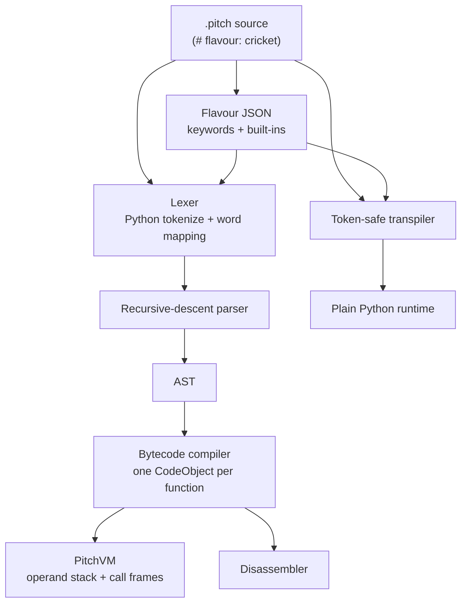

# Pitch: cricket-flavoured Python with its own bytecode VM

Pitch is a small Python-like language toolkit. You write programs using **flavours**
(Python with renamed keywords and renamed built-in functions), and Pitch can either run
them on **PitchVM**, a stack-based bytecode virtual machine written from scratch, or
translate them into ordinary Python. The runtime uses only the Python 3.8+ standard library.

What is included:

- A lexer, recursive-descent parser, bytecode compiler, VM and disassembler (`pitchvm/`).
- Flavours stored as JSON files, with a command and a wizard to create new ones.
- Renaming of **built-in functions** (`print` can be `scoreboard`, `len` can be `balls`).
- A token-safe transpiler (flavour source to plain Python).
- An interactive REPL, a command-line tool and a numbered menu.
- Eight example programs and a unit-test suite (75 tests).

## Architecture



## Install and quick start

Run these commands from the project root folder.

```bash
python -m pip install -e .          # optional: gives you the `pitch` command
python pitch.py run examples/scorecard.pitch
python pitch.py run examples/factorial.pitch --mode transpile
python pitch.py dis examples/run_rate.pitch
python pitch.py transpile examples/primes.pitch -o primes.py
python pitch.py repl --flavour cricket
python pitch.py                      # numbered menu
python -m unittest -v                # run all tests
```

After `pip install -e .` you can type `pitch` instead of `python pitch.py`. The shorthand
`pitch examples/scorecard.pitch` also works.

Pitch picks the flavour in this order: the `--flavour` option, then a first-lines
directive such as `# flavour: banglish` inside the file, then the default (`cricket`).

## Flavours

All flavours keep the normal English words working too, so you can mix them freely.

| Python | Cricket | Banglish |
|---|---|---|
| `if` | `appeal` | `jodi` |
| `elif` | `recheck` | `nahole_jodi` |
| `else` | `notout` | `nahole` |
| `while` | `innings` | `jotokkhon` |
| `for` | `face` | `proti` |
| `in` | `within` | `moddhe` |
| `True` | `six` | `shotti` |
| `False` | `duck` | `mittha` |
| `None` | `dot` | `shunno` |
| `and` | `partner` | `ebong` |
| `or` | `otherwise` | `ba` |
| `not` | `wide` | `na` |
| `def` | `bowl` | `banao` |
| `return` | `deliver` | `ferot` |
| `break` | `retire` | `thamo` |
| `continue` | `nextball` | `cholo` |
| `pass` | `leave` | `chharo` |
| `class` | `team` | `shreni` |
| `try` | `attempt` | `chesta` |
| `except` | `dropped` | `dhoro` |
| `finally` | `stumps` | `shesh` |
| `raise` | `signal` | `tolo` |
| `import` | `enter` | `ano` |
| `from` | `pavilion` | `theke` |
| `with` | `under` | `shathe` |
| `as` | `called` | `hishebe` |
| `lambda` | `shot` | `chhoto` |
| `print` | `scoreboard` | `dekhao` |
| `input` | `ask_captain` | `jiggesh` |
| `len` | `balls` | `dorgho` |
| `str` | `as_text` | `lekha` |
| `int` | `whole` | `purno` |
| `float` | `decimal` | `doshomik` |
| `bool` | `verdict` | `haanna` |
| `abs` | `distance` | `nirpekkho` |
| `round` | `roundoff` | `gol` |
| `min` | `lowest` | `sobcheye_choto` |
| `max` | `highest` | `sobcheye_boro` |
| `sum` | `tally` | `jogfol` |
| `range` | `overs` | `porjay` |
| `sorted` | `ranked` | `shajao` |
| `list` | `squad` | `talika` |

Notes on how renaming behaves:

- **Keyword aliases** are always replaced (`appeal` always means `if`).
- **Built-in aliases** are replaced only when they are *called*, i.e. followed by `(`. So
  `balls = 3` is a normal variable while `balls("abc")` calls `len`.
- Names after a dot (`items.appeal`) are attributes and are never renamed.
- Strings, comments and longer names such as `appealing` are never touched.
- In the transpiler, names inside f-string expressions are translated only on Python 3.12+.

The sample flavour `campus` lives in the project's `flavours/` folder (not in the package) to
show how user flavours work. `python pitch.py run examples/campus_marks.pitch` uses it.

## Creating your own flavour

A flavour is one JSON file. Keys are the Python words, values are your words. Anything you
leave out keeps its normal Python name.

```json
{
  "description": "My kitchen words",
  "keywords": { "if": "taste", "else": "serve", "while": "stir", "for": "chop", "in": "from_bowl" },
  "builtins": { "print": "plate", "len": "portions", "range": "servings" }
}
```

Three ways to create one:

```bash
python pitch.py flavour new kitchen                     # writes ./flavours/kitchen.json to edit
python pitch.py flavour new kitchen --from cricket      # start from another flavour's words
python pitch.py flavour wizard                          # answer one prompt per word
```

Then use it with `--flavour kitchen` or with a `# flavour: kitchen` line at the top of a file.
Pitch searches, in order: the built-in `pitchvm/flavours/`, `./flavours/` and every folder listed
in the `PITCH_FLAVOURS` environment variable (later folders override earlier ones).

Every alias is validated: it must be one identifier, must not be a Python keyword or a
built-in function name, and must not be used twice. Useful commands:

```bash
python pitch.py flavour list          # all flavours and where they come from
python pitch.py flavour show cricket  # every word of one flavour
```

## The language the VM understands

| Area | Supported on PitchVM |
|---|---|
| Values | int, float, str, bool, None, lists |
| Operators | `+ - * / // % **`, unary `+ -`, `and or not`, comparisons (chained too), `in`, `not in`, `a if c else b` |
| Statements | assignment, `x += 1` style updates, `list[i] = v`, `if/elif/else`, `while`, `for x in ...`, `break`, `continue`, `pass` |
| Functions | `def` with default values, keyword arguments, `return`, recursion (depth limit 200) |
| Lists and strings | indexing (including negative), and the methods `append pop insert remove extend reverse sort count index upper lower strip split join replace startswith endswith title` |
| Built-ins | `print input len str int float bool abs round min max sum range sorted list` |

Not supported on the VM (use `--mode transpile`, which runs real Python): classes, `try/except`,
`import`, `with`, `lambda`, f-strings, dictionaries, tuples, slicing, comprehensions, nested
functions and closures. The VM reports these with a clear message instead of failing silently.

Every example gives the same output on the VM and when transpiled; a test checks this.

## Command reference

| Command | What it does |
|---|---|
| `pitch run FILE [--flavour F] [--mode pvm\|transpile] [--max-steps N]` | Run a file. `--max-steps` stops runaway loops |
| `pitch dis FILE [--flavour F]` | Show the bytecode listing |
| `pitch transpile FILE [-o OUT] [--flavour F]` | Convert to plain Python |
| `pitch repl [--flavour F] [--mode pvm\|transpile]` | Interactive prompt (`:flavour NAME` switches flavour) |
| `pitch flavour list / show NAME / new NAME / wizard` | Manage flavours |
| `pitch` | Numbered menu: run, create-and-run a file, REPL, disassemble, transpile, flavours, new flavour |

## Opcode reference

| Opcode | Meaning |
|---|---|
| `LOAD_CONST` / `LOAD_NAME` | Push a literal / a variable (local scope first, then global) |
| `STORE_NAME` | Pop the top value into a variable |
| `BINARY_ADD/SUB/MUL/DIV/FLOORDIV/MOD/POW` | Pop right then left operand, push the result |
| `UNARY_NEG/POS/NOT` | One-operand operators |
| `COMPARE_OP` | Comparison or membership test (operator is the argument) |
| `BUILD_LIST n` | Pop `n` values into a new list |
| `BINARY_SUBSCR` / `STORE_SUBSCR` | `obj[index]` read / write |
| `GET_ITER` / `FOR_ITER target` | Start a loop iterator / fetch next value or jump to the loop end |
| `JUMP` | Unconditional jump |
| `POP_JUMP_IF_FALSE/TRUE` | Pop a value and jump on false / true |
| `JUMP_IF_FALSE_OR_POP` / `JUMP_IF_TRUE_OR_POP` | Short-circuit `and` / `or` |
| `MAKE_FUNCTION` | Build a function object from a code object and its default values |
| `CALL` / `CALL_METHOD` | Call a function or built-in by name / call an allowed method |
| `RETURN_VALUE` | Pop the result and return to the caller frame |
| `POP_TOP` / `PRINT_EXPR` | Discard a value / echo it in the REPL |
| `HALT` | Stop the program |

## Design notes

- PitchVM keeps a **list of frames**. A user function call pushes a new frame (own operand stack
  and local variables) and `RETURN_VALUE` pops it, so recursion does not use Python's call stack.
- Jump addresses are absolute instruction indexes inside one code object, patched after the loop
  or branch body has been compiled.
- A `for` loop keeps its iterator on the operand stack. `break` emits `POP_TOP` first so the stack
  stays balanced, `continue` jumps back to `FOR_ITER`.
- `a < b < c` is rewritten to `(a < b) and (b < c)`, and `x += 1` to `x = x + 1`, in the parser.
- Division follows Python (`/` is always true division), so VM and transpiled output match.
- Errors carry line numbers and function names, for example
  `PitchRuntimeError: line 5 in required_rate(): ZeroDivisionError: division by zero`.
- Method calls use a whitelist so programs cannot reach internal attributes such as `__class__`.
- Functions look up variables in their own scope and then in globals (no `global` keyword and no
  closures). Assigning inside a function always creates a local variable.
- The transpiler edits only `tokenize.NAME` tokens, from the end of the file to the start, so the
  column positions of earlier edits stay valid.

## Project layout

```
pitch_project/
  pitch.py              command line tool, REPL, menu, flavour wizard
  pitchvm/
    flavours.py         loading, validating and creating flavours
    flavours/*.json     built-in flavours (cricket, banglish)
    lexer.py parser.py compiler.py opcodes.py vm.py disassembler.py transpiler.py errors.py
  flavours/campus.json  sample user flavour
  examples/*.pitch      runnable examples
  test_*.py             unit tests
  pyproject.toml
```
